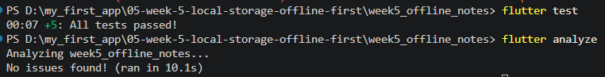
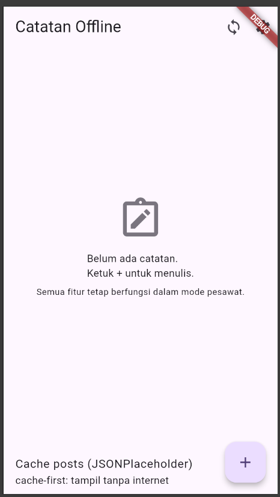
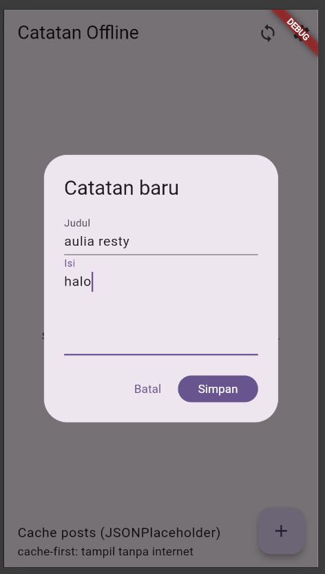
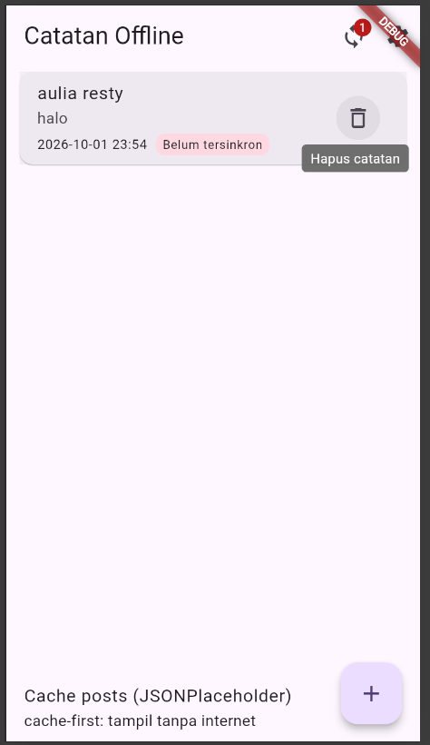
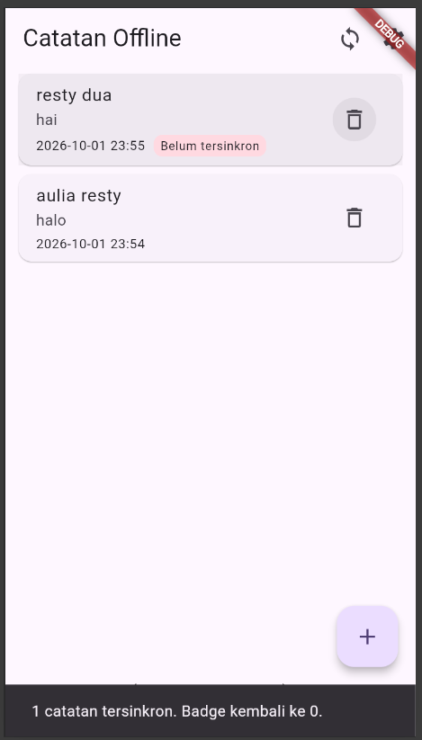
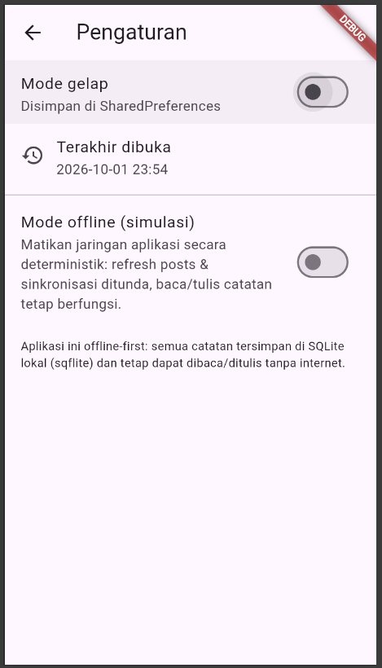
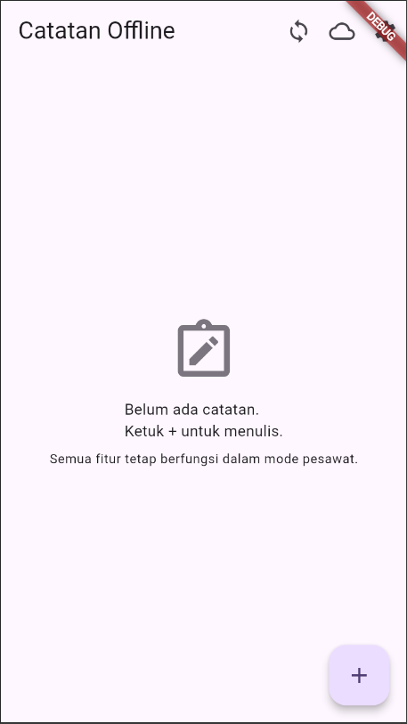
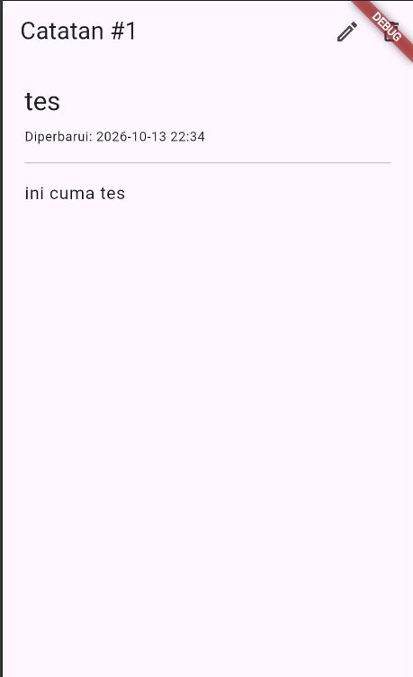
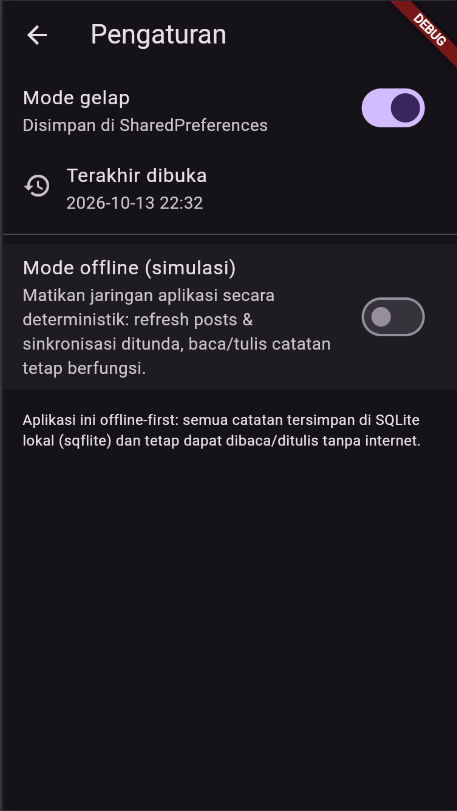

# Week 5 — Local Storage & Offline-First (Flutter Notes)

### AI Prompt
Compare SharedPreferences, Hive, sqflite (SQLite), and Drift for an offline Flutter Notes app with CRUD notes and theme preferences, covering query complexity, relationships, stream reactivity, type safety, boilerplate, testing, trade-offs, final recommendations for each use case, and a table/schema design for 1,000+ notes.

### AI Verification Checklist

| # | Verification Question | Finding | Status |
|---|---|---|---|
| 1 | Does AI use SharedPreferences for notes? | **No.** Notes use **sqflite**, while SharedPreferences is only for theme and last-opened data. | ✅ Accepted |
| 2 | Does the schema support sync? | **Yes.** It uses `dirty` and `updated_at` to mark notes that need syncing. | ✅ Accepted |
| 3 | Does AI use streams for real-time updates? | **No.** sqflite has no built-in stream. Riverpod refreshes data after changes, while **Drift** supports streams with `watch()`. | ✅ Verified |
| 4 | Is the boilerplate estimate realistic? | **Yes.** sqflite needs manual SQL and data mapping, while Drift is more convenient but requires `build_runner`. | ✅ Verified |
| 5 | What is the final decision? | **SharedPreferences** for preferences and **sqflite** for notes. **Drift** is an alternative when streams and type-safety are needed. | ✅ Documented |

Detail analisis per kriteria (query, relasi, stream, type-safety, boilerplate,
testing) dan skema 1000+ catatan: [`docs/storage-comparison.md`](docs/storage-comparison.md).

### Uji   



### Hasil yang dicapai






### Refleksi

1. Daftar catatan tidak boleh di SharedPreferences karena harus rewrite penuh setiap simpan, tanpa query, tipe, atau relasi — akan bermasalah saat data banyak.
2. Cache-first cukup untuk data yang boleh sedikit usang seperti posts atau daftar. Untuk harga real-time, gunakan network-first.
3. Dirty flag → antrean sync yang diproses di background agar UI tidak terblokir. Outbox diperlukan jika antrean harus tetap ada setelah restart atau sync semakin panjang.

---

## Week 7 - Clean Architecture refactor

`week5_offline_notes/` direfaktor dari **layer-first** (`lib/{core,database,data,pages}`) menjadi
**feature-first Clean Architecture** (`lib/features/<fitur>/{domain,data,presentation}`), tanpa mengubah
perilaku aplikasi yang terlihat. Fitur: **notes** (SQLite offline CRUD + antrean sync), **posts** (cache-first
JSONPlaceholder), **settings** (SharedPreferences).

### Aturan dependensi

```
presentation ──► domain ◄── data
   (UI, Riverpod)   (entity, kontrak, use case)   (SQLite/Dio/SharedPreferences)
```

- `domain` meng-import **tidak ada** `package:flutter*`, `dio`, `sqflite`, atau `firebase` — pure Dart.
- `data` mengimplementasikan kontrak `domain`; `presentation` hanya melihat abstraksi + use case.
- Mapping (`toMap`/`fromMap`) hanya ada di `data/models/`; entity di `domain/entities/` bersih.
- Kegagalan menyeberang batas sebagai **nilai** (`Failure`), bukan exception mentah dari SQLite/Dio.
- Semua perakitan (DI) ada di provider Riverpod, tidak ada `new Repository()` di widget.

```
lib/
├── main.dart                  # app shell: configureDatabaseFactory + MaterialApp.router
├── routes.dart                # AppRoutes (konstanta) + GoRouter
├── core/                      # failures.dart, format.dart, debug.dart (pure Dart), providers.dart (DI lintas fitur)
├── database/app_database.dart # openAppDb + appDatabaseProvider (infrastruktur SQLite)
└── features/
    ├── notes/{domain,data,presentation}     # domain: entity + kontrak + usecase (GetNotes, AddNote, SyncNotes)
    ├── posts/{domain,data,presentation}     # domain: entity + kontrak + usecase (RefreshPostsCache); halaman PostsCachePage (`/posts`)
    └── settings/{domain,data,presentation}  # domain: kontrak + usecase (ToggleDarkMode)
```

Aturan lintas fitur: sebuah fitur **tidak pernah** meng-import `domain/`, `data/`, maupun
`presentation/` fitur lain termasuk widget. Perpindahan antar-fitur hanya lewat rute
(`AppRoutes` di `lib/routes.dart`), sehingga `notes` tidak tahu apa pun soal `posts`.

### Pemetaan file lama → baru

| Lama (layer-first) | Baru (feature-first) |
|---|---|
| `lib/data/local/note.dart` | `lib/features/notes/domain/entities/note.dart` (entity, tanpa mapping) + `lib/features/notes/data/models/note_model.dart` (mapping) |
| `lib/data/repositories/note_repository.dart` | `lib/features/notes/domain/repositories/note_repository.dart` (interface) + `lib/features/notes/data/repositories/note_repository_impl.dart` (SQLite) |
| `lib/data/sync.dart` → `syncNotes()` | `lib/features/notes/domain/usecases/sync_notes.dart` |
| `lib/data/sync.dart` → `Post`, `loadPostsCacheFirst`, `refreshPostsInBackground`, `_samePosts` | `lib/features/posts/domain/entities/post.dart`, `lib/features/posts/domain/usecases/refresh_posts_cache.dart`, `lib/features/posts/data/models/post_model.dart`, `lib/features/posts/data/repositories/post_repository_impl.dart` |
| `lib/data/prefs.dart` | `lib/features/settings/domain/repositories/prefs_repository.dart`, `lib/features/settings/domain/usecases/toggle_dark_mode.dart` + `lib/features/settings/data/repositories/prefs_repository_impl.dart` |
| `lib/data/providers.dart` | `lib/features/{notes,posts,settings}/presentation/providers/*.dart` + `lib/core/providers.dart` (`forceOfflineProvider`) |
| `lib/pages/notes_page.dart` | `lib/features/notes/presentation/pages/notes_page.dart` |
| `lib/pages/note_detail_page.dart` | `lib/features/notes/presentation/pages/note_detail_page.dart` |
| `lib/pages/settings_page.dart` | `lib/features/settings/presentation/pages/settings_page.dart` |
| `lib/pages/widgets/note_tile.dart` | `lib/features/notes/presentation/widgets/note_tile.dart` |
| `_PostsCacheSection` (di dalam `notes_page.dart`) | `lib/features/posts/presentation/pages/posts_cache_page.dart` (rute `/posts`, dibuka dari ikon AppBar `notes_page.dart`) |
| Router inline di `lib/main.dart` | `lib/routes.dart` |
| `test/note_test.dart` | `test/{get_notes,notes_usecases,note_model,notes_providers,posts_usecases,posts_providers,settings_usecases,settings_providers,note_route,posts_route}_test.dart` + `test/fakes/{fake_note_repository,fake_post_repository,fake_prefs_repository}.dart` |

`lib/data/` dan `lib/pages/` dihapus seluruhnya (tanpa shim/re-export) rincian isi, alasan, dan bukti
ketiadaannya ada di [Folder legacy yang dihapus](#folder-legacy-yang-dihapus).

### Verifikasi sterility (perintah codelab + keluaran apa adanya)


**Cek 1  `presentation` tidak menyentuh data source mentah**

```
$ grep -rnE "Dio\(|openDatabase|getDatabasesPath|FlutterSecureStorage|SharedPreferences\.getInstance|jsonDecode" \
    lib/features/notes/presentation lib/features/posts/presentation lib/features/settings/presentation
$ echo $?
1
```


**Cek 2  `domain` bebas framework**

```
$ grep -rnE "import 'package:flutter|import 'package:dio|import 'package:sqflite|import 'package:firebase" \
    lib/features/notes/domain lib/features/posts/domain lib/features/settings/domain
$ echo $?
1
```


```
$ grep -rnE "import 'package:flutter|import 'package:dio|import 'package:sqflite|import 'package:firebase" lib/core
lib/core/providers.dart:1:import 'package:flutter_riverpod/flutter_riverpod.dart';
$ echo $?
0
```

**Cek 3  tidak ada instansiasi manual di `presentation`**

```
$ grep -rnE "RepositoryImpl\(|Dio\(BaseOptions" \
    lib/features/notes/presentation lib/features/posts/presentation lib/features/settings/presentation
lib/features/notes/presentation/providers/notes_providers.dart:16:  (ref) => NoteRepositoryImpl(openDb: ref.watch(appDatabaseProvider)),
lib/features/posts/presentation/providers/posts_providers.dart:14:  (ref) => PostRepositoryImpl(openDb: ref.watch(appDatabaseProvider)),
lib/features/settings/presentation/providers/settings_providers.dart:11:    Provider<PrefsRepository>((ref) => PrefsRepositoryImpl());
$ echo $?
0
```

**3 hasil, bukan 0.** Semuanya di `presentation/providers/*.dart`, yaitu composition root Riverpod, tempat
perakitan dependency memang seharusnya berada (widget tidak pernah menyentuh repository). Bila cek
dipersempit ke lapisan UI:

```
$ grep -rnE "RepositoryImpl\(|Dio\(BaseOptions" \
    lib/features/notes/presentation/pages lib/features/notes/presentation/widgets \
    lib/features/posts/presentation/pages lib/features/settings/presentation/pages
$ echo $?
1
```

0 hasil: tidak ada halaman/widget yang membuat repository atau `Dio` sendiri.

**Cek 4 — mapping hanya di `data/models/`**

```
$ grep -rnE "toMap|fromMap|toJson" \
    lib/features/notes/domain lib/features/posts/domain lib/features/settings/domain
$ echo $?
1
```

0 hasil: `toMap`/`fromMap` hanya ada di `features/*/data/models/`.

**Cek tambahan (di luar codelab) — tidak ada import lintas fitur di `presentation`**

```
$ grep -rnE "features/(notes|posts|settings)" lib/features/notes lib/features/posts lib/features/settings
$ echo $?
1
```

0 hasil. Sejak cache posts dipindah ke rute `/posts`, perpindahan antar-fitur hanya lewat `AppRoutes`
(`lib/routes.dart`); `notes` tidak meng-import widget/halaman fitur lain.

### Folder legacy yang dihapus

| Folder lama | Isi | Kenapa dihapus | Pengganti |
|---|---|---|---|
| `lib/data/` | `local/db.dart`, `local/note.dart`, `prefs.dart`, `providers.dart`, `repositories/note_repository.dart`, `sync.dart` (6 file, 458 baris) | Menampung entity + mapping + repository konkret + `Post`/`Dio` + semua provider dalam satu layer campur, sehingga arah import tidak dapat ditegakkan (entity tahu `toMap`, provider tahu Dio/sqflite). | `features/*/domain` (entity, kontrak, use case) + `features/*/data` (model, implementasi) + `features/*/presentation/providers` + `core/providers.dart` |
| `lib/pages/` | `notes_page.dart`, `note_detail_page.dart`, `settings_page.dart`, `widgets/note_tile.dart` (4 file) | UI diletakkan jauh dari fiturnya, dan router inline di `main.dart` mengimpor halaman lintas fitur. | `features/{notes,posts,settings}/presentation/pages` + `widgets/`; routing pindah ke `lib/routes.dart` |
| `test/note_test.dart` | Test lama yang menguji repository konkret + provider dari `lib/data/` | Semua tipe yang diujinya sudah tidak ada; diganti test per-lapisan dengan fake repository. | `test/{get_notes,notes_usecases,note_model,notes_providers,note_route,posts_usecases,posts_providers,posts_route,settings_usecases,settings_providers}_test.dart` + `test/fakes/` |

Bukti folder benar-benar hilang dan tidak ada sisa referensi (dijalankan dari `week5_offline_notes/`):

```
$ test -d lib/data; echo $?
1
$ test -d lib/pages; echo $?
1
$ ls lib
core
database
features
main.dart
routes.dart
$ grep -rnE "lib/data/|lib/pages/" lib test
$ echo $?
1
$ grep -rn "export '" lib
$ echo $?
1
```

### Bukti sesudah refactor





### Refleksi Week 7

1. Memindahkan file tidak cukup: pelanggaran Clean Architecture yang nyata ada di *arah import* `Post` + `jsonDecode` + `Dio(` yang tinggal di `lib/data/sync.dart` akan tetap salah meski foldernya bernama`features/`.
2. Entity tanpa mapping memaksa satu tempat serialisasi per model (`data/models/`), sehingga perubahan skema tidak pernah menyentuh `domain`/UI.
3. Failure sebagai nilai membuat `presentation` bisa menampilkan pesan yang tepat tanpa `try/catch` mentah dan mengubah `syncNotes` dari "tidak mungkin gagal" menjadi kegagalan yang bisa dilaporkan ke pengguna.

## 1. Prompt AI (diadaptasi dari AI Prompt Challenge codelab)

> Saya punya aplikasi Flutter offline-first (`week5_offline_notes`) dengan struktur layer-first:
> `lib/core/` (failures, format, debug), `lib/database/app_database.dart`, `lib/data/` (entity `Note` beserta
> `toMap`/`fromMap`, `NoteRepository` konkret, `sync.dart` berisi `Post` + `jsonDecode` + `Dio`,
> `prefs.dart`, dan satu `providers.dart` yang menampung semua provider Riverpod), serta `lib/pages/`
> (notes, note detail, settings, widget `note_tile`).
>
> Refaktor ke Clean Architecture feature-first `lib/features/<fitur>/{domain,data,presentation}` untuk tiga
> fitur: **notes** (SQLite CRUD offline + antrean `dirty`), **posts** (cache-first JSONPlaceholder), dan
> **settings** (SharedPreferences: tema gelap, waktu terakhir dibuka). Terapkan dependency rule
> *presentation → domain ← data*:
> 1. entity di `domain/entities` tanpa `toMap`/`fromMap`;
> 2. kontrak repository di `domain/repositories`, implementasi di `data/repositories`;
> 3. use case di `domain/usecases`, dipanggil presentation;
> 4. `domain` tidak boleh meng-import Flutter/Dio/sqflite/firebase;
> 5. kegagalan menyeberang batas sebagai nilai (`Failure`), bukan exception mentah;
> 6. semua DI di provider Riverpod, tanpa instansiasi repository di widget.
>
> Pertahankan perilaku yang terlihat persis sama (teks dialog, SnackBar, badge dirty, urutan catatan, alur
> cache-first). Jelaskan trade-off-nya, dan jangan biarkan kompatibilitas ke belakang berupa shim/re-export.

## 2. Usulan AI vs keputusan akhir

| # | Usulan | Keputusan akhir | Alasan |
|---|---|---|---|
| 1 | Satu use case per operasi repository: `GetNotes`, `GetNote`, `AddNote`, `UpdateNote`, `DeleteNote`, `SyncNotes`, `CountDirty`, `MarkAllSynced` | **Diterima sebagian**: hanya `GetNotes`, `AddNote`, `SyncNotes` di notes; ditambah satu use case bernilai di fitur lain: `RefreshPostsCache` (posts) dan `ToggleDarkMode` (settings) | Checklist codelab butir 3: use case untuk CRUD satu baris hanya menambah lapisan tanpa nilai. Use case dipakai saat ada **aturan domain**. Codelab Refactoring Challenge #1 juga meminta satu use case di fitur kedua/ketiga. |
| 2 | `forceOfflineProvider` dipindah ke `lib/features/settings/presentation/providers/` karena satu-satunya UI-nya di halaman pengaturan | **Ditolak**: tetap di `lib/core/providers.dart` | Provider ini adalah **DI lintas fitur**: dipakai `notes` (menunda sync) dan `posts` (menunda refresh). Menaruhnya di `settings` membuat dua fitur lain meng-import presentation fitur ketiga. |
| 3 | `lib/database/app_database.dart` dipindah ke `lib/core/` agar semua infrastruktur menyatu | **Ditolak**: tetap `lib/database/` | File itu meng-import `sqflite`, sehingga menaruhnya di `core/` merusak grep sterility #2. |
| 4 | `appDatabaseProvider` dihapus karena tidak terpakai | **Ditolak**: justru disuntikkan ke `NoteRepositoryImpl`/`PostRepositoryImpl` | Codelab mensyaratkan "database opener disuntikkan" — dengan `openDb` sebagai parameter, repository dapat diuji tanpa SQLite. |
| 5 | Repository mengembalikan entity dan melempar exception, presentation yang menangkap | **Ditolak**: repository mengembalikan record `(payload, failure)` | `sealed class Failure` sudah ada di Minggu 5 tetapi tidak diimport siapa pun. Bentuk record membuat UI tidak pernah melihat `DatabaseException`/`DioException`. |
| 6 | Gunakan `freezed`/`json_serializable` untuk model + `Result<T>` generik | **Ditolak** | Menambah `build_runner` dan dependensi baru untuk tiga model; record Dart 3 sudah cukup dan tetap type-safe. |
| 7 | Pisahkan `NoteModel` dan `PostModel` dengan extension `toEntity()` pada entity | **Diterima dengan arah terbalik**: `NoteModel extends Note` + `toEntity()` di model | Entity tidak boleh tahu apa pun soal penyimpanan; subclass + `toEntity()` menjaga `domain` tetap pure tanpa extension yang meng-import `data`. |
| 8 | Pertahankan `Note` lama sebagai tipe yang dipakai UI (alias) | **Ditolak**: hapus `lib/data/` tanpa shim | Instruksi: cutover bersih, tidak ada re-export/alias. |