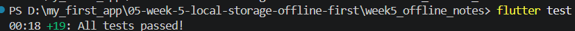
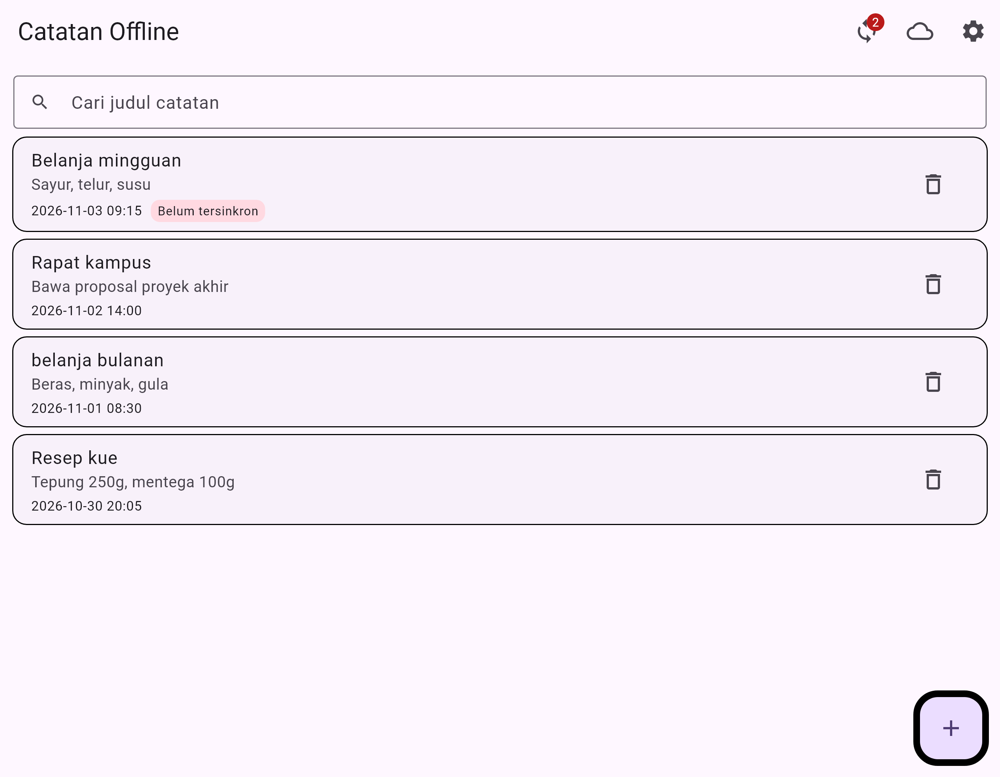
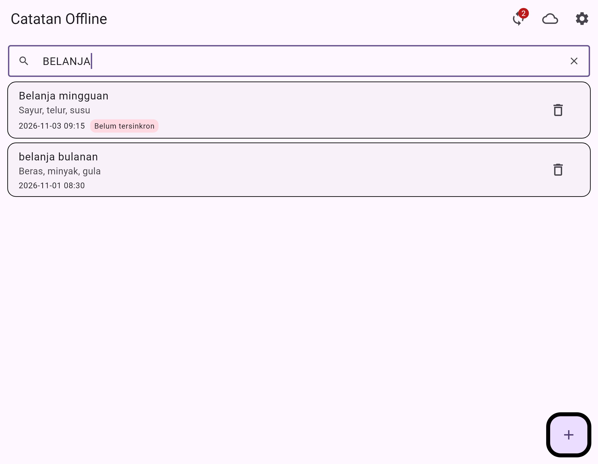
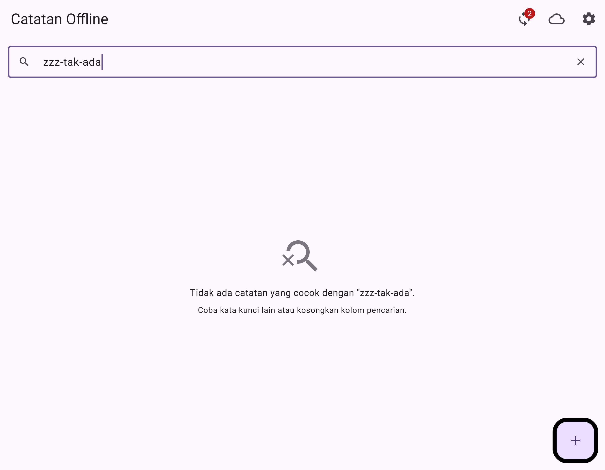
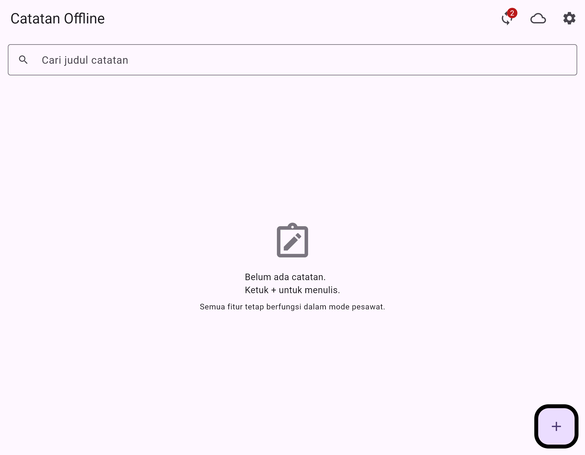

## Week 9 — AI-Assisted Development (search by title)

Melanjutkan project yang sama (`week5_offline_notes/`), bukan project baru. Satu fitur kecil
ditambahkan dengan AI lalu diverifikasi, direfaktor, dan didokumentasikan.

### Fitur

**Pencarian judul catatan** (case-insensitive) + **empty state terpisah** untuk "tidak ada hasil".
Aturan filter hidup di `domain`, bukan di widget:

```
widget (NotesSearchField / NotesEmptyState)  -> UI saja
notifier (SearchQueryNotifier)               -> menyimpan query
use case (SearchNotes)                       -> aturan filter, pure Dart
repository (NoteRepository / sqflite)        -> tidak berubah
```

| File | Peran |
|---|---|
| `lib/features/notes/domain/usecases/search_notes.dart` | `SearchNotes.call(List<Note>, String)` trim, lowercase, cocokkan **judul** saja |
| `lib/features/notes/presentation/providers/notes_providers.dart` | `searchQueryProvider`, `searchNotesProvider`, `filteredNotesProvider` |
| `lib/features/notes/presentation/widgets/notes_search_field.dart` | kolom pencarian + tombol clear |
| `lib/features/notes/presentation/widgets/notes_empty_state.dart` | dua cabang: belum ada catatan vs pencarian kosong |

### Flutter Test


| Kondisi | Screenshot |
|---|---|
| Semua catatan + kolom pencarian |  |
| Query `BELANJA` |  |
| Query `zzz-tak-ada` |  |
| Daftar kosong → empty state bawaan |  |