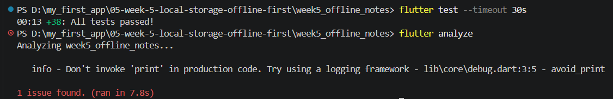
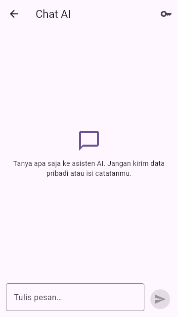
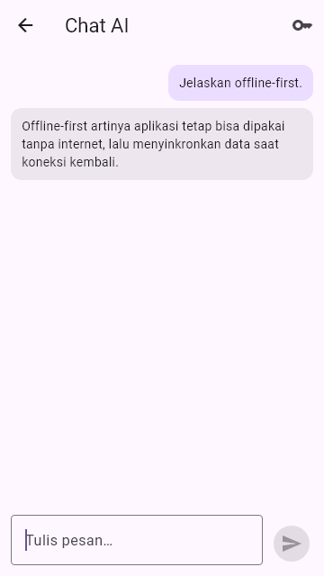
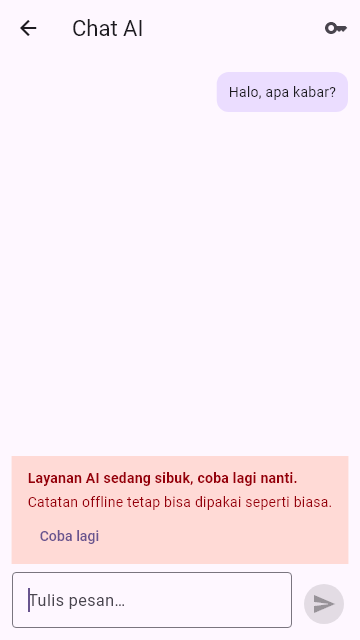

# Week 10 - AI Feature Integration

**Feature:** a Gemini chat assistant inside the existing offline-first notes app.

## What the feature does

- A new **Chat AI** screen (`/chat`), reachable from one button in the notes AppBar.
- The user types a question (max **500 characters**) and gets a **streamed** answer from `gemini-3.8-flash`.
- The API key is entered at runtime and stored with `flutter_secure_storage`, it never appears in code, tests, logs, URLs, or screenshots.
- The AI is a **general assistant only**. The app never sends notes or any personal data.

## How to save the API key

1. Open <https://aistudio.google.com/apikey> and copy your key.
2. Run the app and open **Chat AI** (chat icon in the notes AppBar).
3. Tap the **key icon** in the chat AppBar → paste the key into the obscured
   field → **Simpan**.
4. The key is written to platform secure storage under `gemini_api_key`
   (Android Keystore / iOS Keychain / Windows DPAPI / browser secure context).
   "Hapus kunci" removes it.

The key is never baked into the build, never read from a `.env` file, and never
printed. If it is missing, the chat shows *"API key Gemini belum diatur."* with
an **Atur API key** button.

## Flutter Test & Analyze

## Screenshots

| File | State |
|---|---|
| `screenshots/chat_empty.png` | empty chat, privacy hint |
| `screenshots/chat_finished.png` | user question + completed streamed answer |
| `screenshots/chat_error.png` | rate-limit fallback + retry button |

## Risks and mitigation

| Risk | What could happen | Mitigation |
|---|---|---|
| User data leak | Personal data gets sent to Google. On the free tier, Google may also use the input to improve its products. | The chat never reads the notes, only the message typed by the user. The system prompt says not to ask for personal data, and the empty screen has a small reminder. Input is capped at 500 characters. |
| Cost and rate limit | Free quota runs out and Gemini returns 429. | Only one request at a time, since the send button is disabled while waiting. Input is capped at 500 characters. On 429 the user sees "Layanan AI sedang sibuk, coba lagi nanti." with a retry button. |
| API error or service down | Wrong key, server error, timeout, or no internet. | Each cause has its own error type. The user gets a friendly message and a retry button, and a note that offline notes still work. |
| Irrelevant answer | The AI answers wrong or off-topic. | The system prompt asks for short answers in Indonesian. Answers are never saved into notes, and the user can retry. |
| API key leak | Key ends up in code, Git, logs, URLs, or screenshots. | The key is typed in the app and stored with `flutter_secure_storage`. It goes in the `x-goog-api-key` header, and a test checks the URL has no key. Tests use fakes. |

---

## Reflection

**1. Which AI feature was integrated, and why?**
A chat with Gemini where the answer shows up while it streams. Chat was picked because it needs no camera or microphone permission, and it is easy to test with a fake repository, so the tests never touch the real API.

**2. How is user privacy protected?**
- Only the typed message is sent. The notes are never read.
- The system prompt tells the AI not to ask for or repeat personal data.
- The empty screen has a short reminder not to share personal data.
- The 500-character limit makes big accidental pastes less likely.
- The API key is stored with `flutter_secure_storage` and sent in a header, so it stays out of URLs and logs.
- One limit to be aware of: on the free tier, Google may use the input to improve its products. So the chat is not meant for private information.

**3. What fallback is there when the AI service fails?**
- The user sees a friendly message, not a crash or a raw error.
- A wrong or missing key shows a button that opens the key dialog.
- Rate limit, server error, timeout, and no internet all show "Layanan AI sedang sibuk, coba lagi nanti." with a retry button.
- Every error panel says the offline notes still work, so the rest of the app is not affected.
- The empty answer bubble is removed on error, so only the error panel is left.

**4. One thing learned about AI UX on mobile**
An AI feature needs clear states (waiting, answering, failed, and no key set). When a request fails, the screen should say what to do next, like retry or set the key, and not just leave an empty bubble. Disabling the send button while an answer is coming also matters, because one extra tap can send the same message twice.