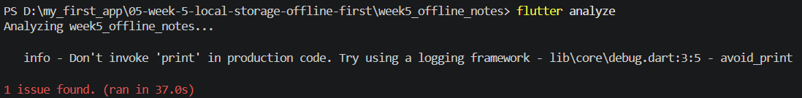
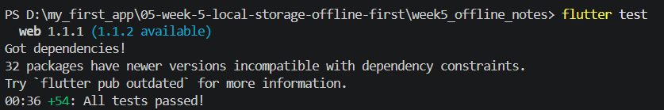
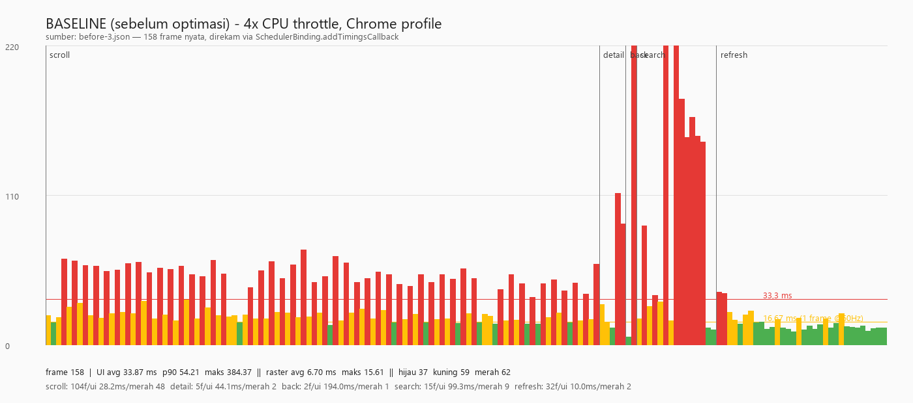
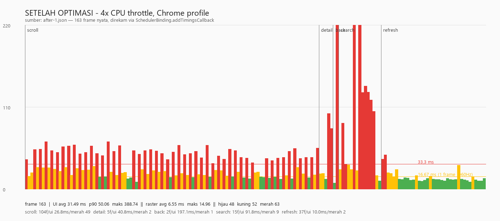

# Offline Notes - Week 11: Optimasi Performa

Aplikasi Offline Notes merupakan aplikasi pencatatan berbasis Flutter yang menggunakan SQLite sebagai penyimpanan lokal dan Riverpod untuk pengelolaan state. Pada Week 11, dilakukan beberapa perbaikan untuk mengurangi proses yang tidak diperlukan, mengoptimalkan penggunaan cache, serta memperbaiki pengelolaan memori.

---

## 1. Fitur Aplikasi

| Fitur | Keterangan |
|---|---|
| **Catatan offline-first** | Pengguna dapat menambah, melihat, mengubah, dan menghapus catatan yang tersimpan di SQLite lokal tanpa koneksi internet. |
| **Pencarian judul** | Pencarian dilakukan langsung mengikuti input pengguna dan tidak membedakan huruf besar maupun kecil. |
| **Antrean sinkronisasi** | Menampilkan jumlah catatan yang belum tersinkronisasi melalui badge. Pengguna dapat menjalankan proses sinkronisasi untuk menandai catatan sebagai tersinkron. |
| **Mode offline (simulasi)** | Menampilkan banner ketika aplikasi berada dalam mode offline dan memberikan penundaan pada proses sinkronisasi. |
| **Chat AI (Week 10)** | Menggunakan streaming SSE untuk berkomunikasi dengan Gemini. API key disimpan melalui secure storage. |
| **Cache posts (Week 5)** | Menggunakan pendekatan cache-first untuk mengambil data dari JSONPlaceholder dengan SQLite sebagai penyimpanan cache. |
| **Pengaturan** | Menyediakan pilihan mode gelap yang tersimpan menggunakan shared_preferences. |

## 2. Perubahan pada Week 11

- **Pull-to-refresh:** Fitur tarik untuk memperbarui daftar catatan ditambahkan karena sebelumnya belum tersedia.
- **Daftar tetap tampil saat refresh:** Sebelumnya, ketika proses refresh berjalan, seluruh daftar catatan diganti dengan indikator loading karena menggunakan AsyncLoading. Setelah diperbaiki, daftar lama tetap ditampilkan sampai data terbaru selesai dimuat. Indikator refresh tetap muncul ketika pengguna menarik daftar.

**Perubahan untuk optimasi performa**

| No. | Berkas | Perubahan |
|---|---|---|
| F1 | widgets/note_tile.dart | Memisahkan bagian metadata menjadi _NoteMeta dan _SyncBadge. Untuk catatan yang tidak memiliki status dirty, tampilan cukup menggunakan satu Text. |
| F1 | pages/notes_page.dart | Menonaktifkan addAutomaticKeepAlives dan menambahkan ValueKey(note.id) pada item daftar. |
| F2 | pages/notes_page.dart | Mengurangi ketergantungan NotesPage terhadap provider dengan memisahkan beberapa bagian menjadi _SyncBadgeButton, _OfflineBanner, _NotesListSection, dan _EmptyStateSection. |
| F2 | widgets/notes_search_field.dart | Menghapus penggunaan setState dan menggantinya dengan ValueListenableBuilder untuk mengatur ikon clear. |
| F2 | providers/notes_providers.dart | Mengubah proses refresh agar tidak langsung menampilkan AsyncLoading. |
| F4 | data/repositories/note_repository_impl.dart | Menambahkan cache baca dan invalidasi cache secara lebih spesifik melalui _upsertCache dan _markCacheSynced. |
| F5 | widgets/note_editor_dialog.dart | Membuat dialog editor dengan controller yang dikelola oleh State dan dipanggil dispose() ketika tidak lagi digunakan. |

## 3. Pengujian Aplikasi

| File | Pengujian |
|---|---|
| test/note_repository_cache_test.dart | 9 test untuk memastikan cache dan query SQLite tetap sesuai setelah proses add, update, delete, dan markAllSynced. Pengujian juga mencakup identitas list, unmodifiable, serta pemulihan ketika terjadi kegagalan. |
| test/note_editor_dialog_test.dart | 7 test untuk memeriksa judul pada mode tambah dan edit, nilai awal, tombol Batal, validasi judul, proses trim, dispose setelah dialog dibuka 10 kali, serta bodyMaxLines. |

## 4. Hasil Pengukuran Performa

| Metrik | Sebelum | Sesudah | Perubahan |
|---|---:|---:|---:|
| UI build average | 33,87 ms | 31,49 ms | −7,0% |
| UI p90 | 54,21 ms | 49,16 ms | −9,3% |
| UI max | 420,48 ms | 394,05 ms | −6,3% |
| Raster average | 6,70 ms | 6,62 ms | −1,2% |
| Frame hijau | 37 | 43 | +16,2% |
| Frame kuning | 50 | 52 | +4,0% |
| Frame merah | 63 | 63 | 0% |

Pada pengujian sebelum optimasi, terdapat 158 frame dengan 63 frame merah. Frame merah paling banyak muncul ketika membuka halaman detail, kembali ke daftar, dan pada awal proses pencarian.

Setelah optimasi, jumlah frame meningkat menjadi 163 dengan jumlah frame merah yang masih sama, yaitu 63. Distribusi frame menjadi lebih merata dan nilai p90 mengalami penurunan.

