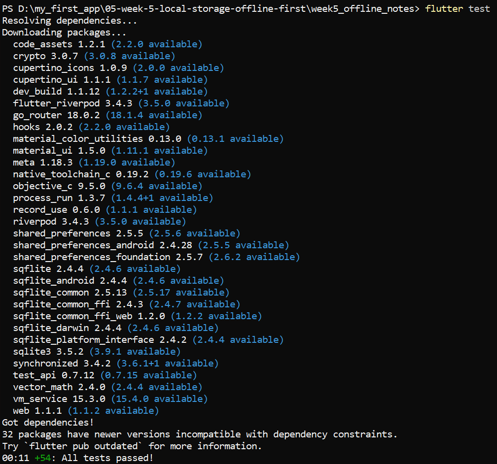
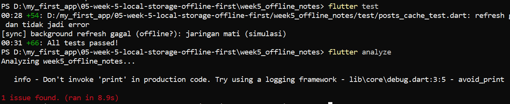
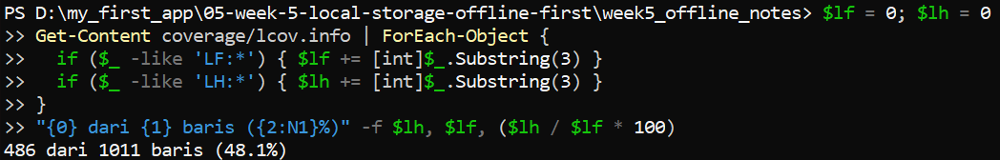
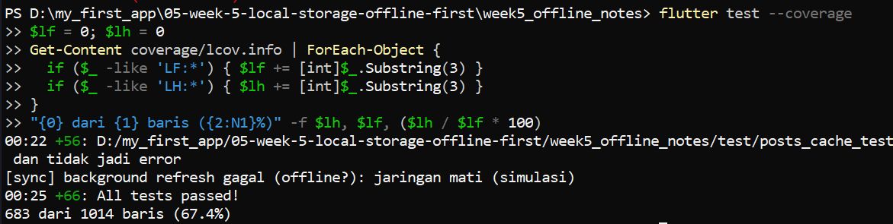

## Week 12 Pengujian dan Jaminan Kualitas

### 1. Skenario yang diuji

| Skenario | Cakupan | File tes |
|---|---|---|
| Jalur sukses | CRUD catatan lewat cache repository, addNote lalu syncNotes membersihkan antrean dirty, cache posts tampil lebih dulu lalu diperbarui, streaming jawaban AI muncul bertahap | test/note_repository_cache_test.dart, test/sync_regression_test.dart, test/posts_cache_test.dart, test/chat_screen_test.dart |
| Kasus tepi | Batas 500 dan 501 karakter pesan, parseNoteId untuk abc, 0, -1, dan 1, pencarian tanpa memedulikan huruf besar kecil dan query berisi spasi saja, SSE yang terpotong antar chunk, karakter multibyte yang terbelah, bagian thought diabaikan, getNote dengan id yang tidak ada | test/chat_send_message_test.dart, test/parse_note_id_test.dart, test/search_filter_test.dart, test/notes_empty_state_test.dart, test/gemini_ai_repository_test.dart, test/note_repository_cache_test.dart |
| Kegagalan | Database gagal dibaca lalu ErrorView tampil, refresh posts gagal tetapi cache tetap tampil tanpa error, HTTP 401, 429, dan 500 serta timeout dan koneksi gagal dipetakan ke AiFailure, API key kosong, input kosong atau terlalu panjang, mode offline menunda sinkronisasi | test/notes_page_test.dart, test/posts_cache_test.dart, test/gemini_ai_repository_test.dart, test/chat_send_message_test.dart |
| Regresi | Chip Belum tersinkron tidak hilang setelah sinkronisasi, serta tampilan halaman catatan dengan repository tiruan (tombol tambah, tombol sync, dan kolom cari) | test/sync_regression_test.dart, test/notes_page_test.dart |
| End-to-end | Aplikasi dijalankan, catatan ditambah, chip dirty muncul, tombol sync ditekan, lalu chip hilang | integration_test/app_test.dart |

Total ada 66 tes unit dan widget, ditambah 1 integration test.

### 2. Hasil

- flutter test lulus 66 tes, sebelumnya 54 tes.

- flutter analyze menemukan 1 info lama, yaitu avoid_print pada baris 3 di lib/core/debug.dart. Print tersebut berada di dalam assert dan sudah ada sebelum pekerjaan ini. Tidak ada error atau warning baru.
- Coverage naik dari 48,1% (486 dari 1011 baris) menjadi 67,4% (683 dari 1014 baris).

- Integration test lulus di HP fisik dengan perintah flutter test integration_test/app_test.dart -d device_id. Lognya ada di docs/week12-integration.txt.

### 3. Bug regresi sync

NotesNotifier.syncNotes sebelumnya hanya me-refresh dirtyCountProvider. Database sudah bersih, tetapi notesProvider masih memegang list lama dengan dirty bernilai true. Akibatnya chip Belum tersinkron tetap tampil dan badge tidak sesuai dengan daftar.

Tes regresi di test/sync_regression_test.dart gagal sebelum perbaikan. Pengecekan database lolos, sedangkan pengecekan notesProvider gagal karena hasil yang diharapkan list kosong, tetapi isinya masih Catatan B dan Catatan A. Lognya ada di docs/week12-sync-sebelum-fix.txt.

Perbaikannya berupa penambahan await refresh() dan ref.invalidate(noteProvider) sebelum dirtyCountProvider di-refresh. Setelah itu tes lulus (log di docs/week12-sync-sesudah-fix.txt) dan seluruh 66 tes tetap hijau.

### 4. Kendala integration test

- Cache paket Flutter berada di drive C, sedangkan proyek berada di drive D. Perbedaan drive ini membuat kompilasi Kotlin gagal menghitung path relatif. Masalah diatasi dengan mematikan incremental build Kotlin lewat kotlin.incremental=false di android/gradle.properties.
- Gradle daemon sempat berhenti mendadak saat build, diduga karena memori. Pengaturan memori di android/gradle.properties adalah 8 GB untuk heap. Build berhasil setelah dijalankan ulang.
- Instalasi APK sempat gagal dengan pesan INSTALL_FAILED_INSUFFICIENT_STORAGE karena memori internal HP penuh. Setelah ruang penyimpanan dibersihkan, instalasi berhasil.

### 5. Temuan yang belum diperbaiki

1. postsProvider memicu refresh jaringan dua kali dalam satu siklus perubahan, yaitu pada build pertama dan pada rebuild setelah postsRevisionProvider.bump(). Hal ini terbukti lewat test/posts_cache_test.dart.
2. ref.watch(forceOfflineProvider) dibaca setelah await repository.readCache() di posts_providers.dart, sehingga dependensinya terdaftar terlambat dan rawan bermasalah jika urutan build berubah.
3. Flag mode offline tidak memengaruhi fitur chat dan tidak tersimpan permanen, sehingga hilang saat aplikasi ditutup.
4. Catatan dengan updated_at yang sama tidak punya tiebreaker berdasarkan id, sehingga urutan antara cache dan tabel bisa berbeda.

### 6. Refleksi

1. **Bug apa yang paling mungkin terlewat tanpa pengujian yang Anda tulis?**
   Bug regresi sync. Setelah syncNotes, database sudah bersih dan badge dirty sudah 0, tetapi notesProvider masih memegang list lama yang berisi dirty bernilai true, sehingga chip Belum tersinkron tetap muncul. Tes yang hanya mengecek tabel dan countDirty akan tetap lulus padahal tampilannya salah. Hanya test/sync_regression_test.dart yang mengecek state provider, sehingga bug ini ketahuan. Hal serupa terjadi pada refresh posts yang ternyata dipanggil dua kali, dan itu baru terlihat setelah fake dipasang untuk menghitung jumlah panggilan.

2. **Bagian mana yang perlu fake, dan bagaimana fake itu membuat pengujian lebih konsisten?**
   Fake dipakai untuk NoteRepository, PostRepository, AiRepository, ApiKeyStore, dan HttpClientAdapter, supaya tes tidak bergantung pada SQLite, jaringan, secure storage, atau waktu sungguhan.

3. **Apa perbedaan nilai yang diberikan pengujian widget dan pengujian integrasi pada fitur Anda?**
   Pengujian widget dengan override provider cocok untuk memeriksa logika UI, interaksi, dan state Riverpod secara cepat dan spesifik. Kekurangannya, tes ini tidak menyentuh sqflite asli, go_router, maupun urutan startup aplikasi. Pengujian integrasi menjalankan aplikasi dengan database dan navigasi sungguhan, sehingga alur tambah catatan, chip dirty muncul, tekan tombol sync, lalu chip hilang terbukti berjalan utuh, termasuk dialog editor dan uploadDelay yang asli. Hal itu tidak bisa dibuktikan oleh tes widget karena repository-nya diganti fake. Harganya lebih mahal karena butuh build Gradle, instalasi ke perangkat, dan waktu jalan yang lebih lama.