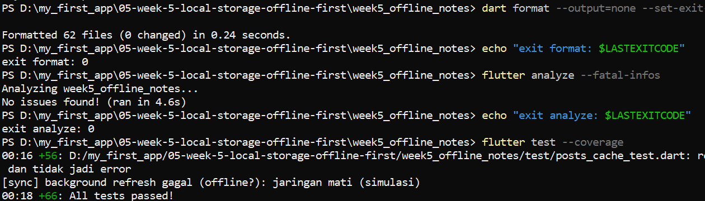
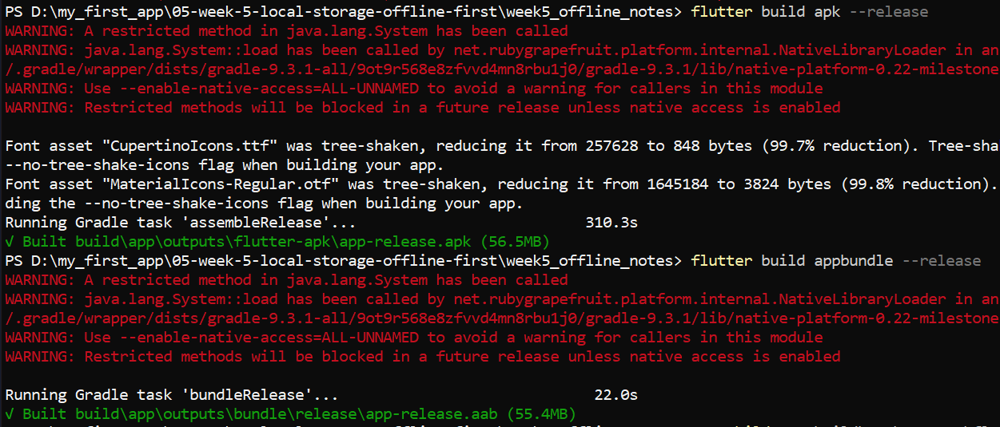
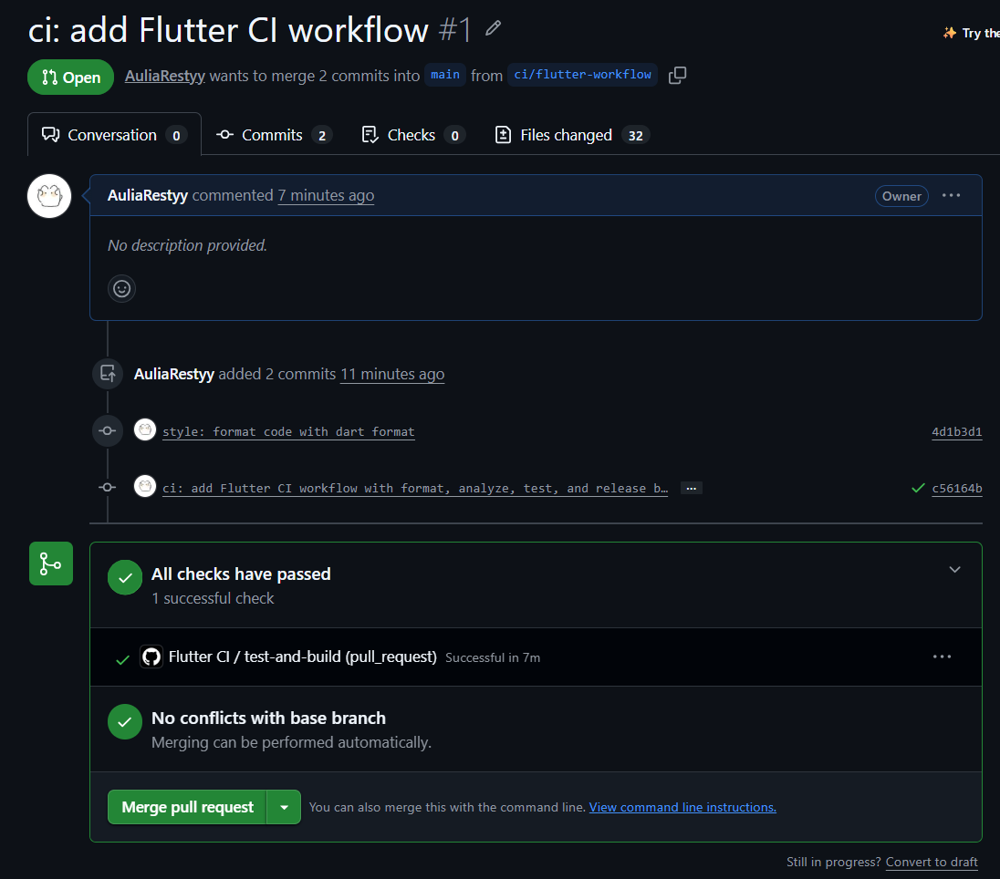
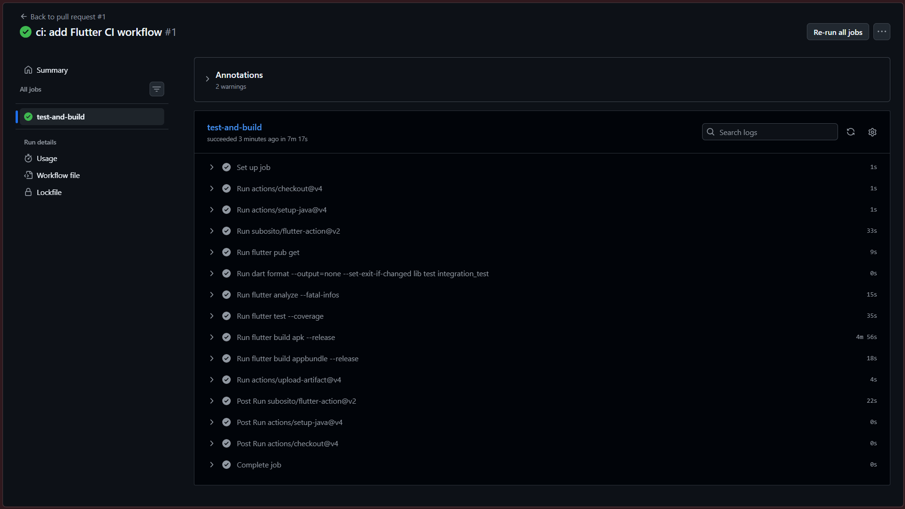
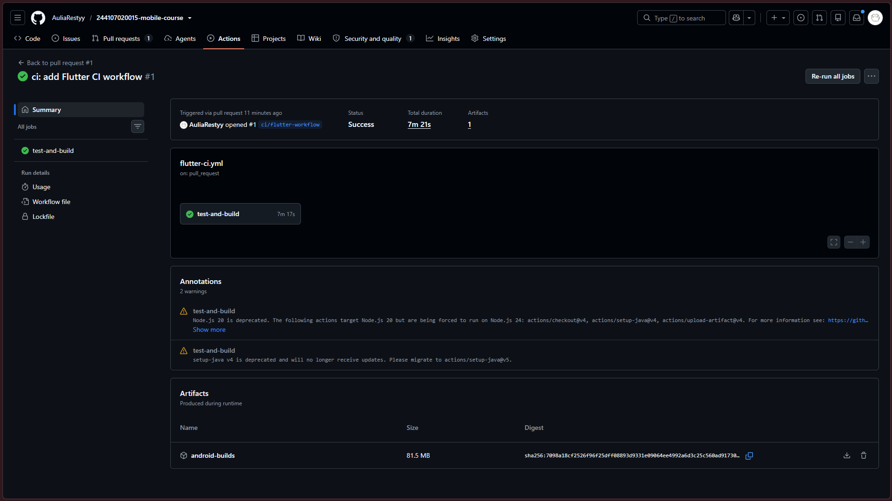
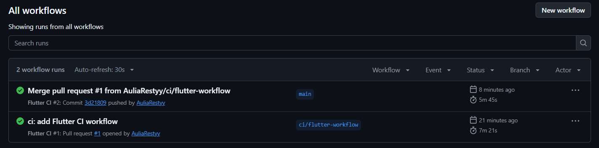
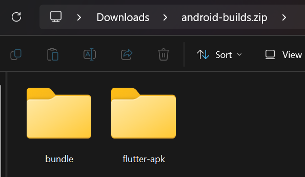

## Week 13 CI/CD dan Otomatisasi

### 1. Workflow CI

File workflow ada di .github/workflows/flutter-ci.yml, di root repository. Posisinya di root karena repository ini berisi banyak folder minggu. Supaya perintahnya jalan di project yang benar, dipakai pengaturan working-directory ke folder week5_offline_notes.

| Bagian | Isi |
|---|---|
| Nama | Flutter CI |
| Pemicu | push dan pull request ke main, plus bisa dijalankan manual |
| Filter path | Hanya jalan kalau folder week5_offline_notes atau file workflow berubah |
| Permission | contents read saja |
| Concurrency | Run lama dibatalkan kalau ada run baru di branch yang sama |
| Runner | ubuntu-latest, Java 17 (Temurin), Flutter 3.47.2 stable |

Urutan step di job test-and-build:

1. Checkout kode
2. Siapkan Java dan Flutter
3. flutter pub get
4. Cek format dengan dart format di folder lib, test, dan integration_test
5. flutter analyze dengan fatal-infos, jadi info kecil pun bikin job gagal
6. flutter test dengan coverage
7. flutter build apk release
8. flutter build appbundle release
9. Upload APK dan AAB sebagai artefak android-builds, disimpan 7 hari

Versi Flutter sengaja dipatok ke 3.47.2 supaya hasil format dan analisis di GitHub sama dengan di laptop.

### 2. Dicek di lokal dulu

Sebelum push, semua step dijalankan dulu di laptop.

- Format selesai dengan exit code 0
- Analyze bersih, No issues found
- Test lulus 66 dari 66
- Build release menghasilkan app-release.apk 56,5 MB dan app-release.aab 55,4 MB

Ada dua hal yang ketahuan dan dibereskan sebelum push.

- 30 dari 62 file Dart ternyata belum sesuai format Dart 3.13. Semuanya dirapikan pakai dart format, lalu dijadikan satu commit sendiri (4d1b3d1).
- Analyze menemukan satu info avoid_print di lib/core/debug.dart. Print-nya ada di dalam assert dan cuma jalan di mode debug, jadi cukup diberi komentar ignore.

Satu kendala lagi, dart format di seluruh folder sempat error di Windows karena ikut membaca folder build yang path-nya kepanjangan. Makanya pengecekan format dibatasi ke lib, test, dan integration_test, baik di lokal maupun di workflow.

### 3. Hasil pipeline

Workflow dijalankan lewat pull request dari branch ci/flutter-workflow ke main, lalu jalan lagi setelah merge.

| Run | Pemicu | Hasil | Durasi |
|---|---|---|---|
| Pull request nomor 1 | pull_request | Berhasil | 7m 21s |
| Setelah merge ke main | push | Berhasil | 5m 45s |

- Commit di pull request ada dua, yaitu 4d1b3d1 (format kode) dan c56164b (workflow CI)
- URL run pull request: https://github.com/AuliaRestyy/244107020015-mobile-course/actions/runs/45379826920
- URL run setelah merge: https://github.com/AuliaRestyy/244107020015-mobile-course/actions/runs/45381972577
- SHA commit hasil merge: 3d21809

### 4. Artefak

Artefak android-builds ukurannya 81,5 MB, isinya app-release.apk dan app-release.aab. Bisa diunduh dari bagian Artifacts di halaman run (tab Actions) dan otomatis terhapus setelah 7 hari. File hasil unduhan sudah dibuka dan isinya sesuai.

### 5. Versi

Versi sekarang di pubspec.yaml adalah 1.0.0+1, dan versi berikutnya direncanakan 1.0.1+2.

- Angka patch naik karena isinya perbaikan dan perapian, belum ada fitur baru
- Build number naik satu untuk tiap unggahan baru
- Tag v1.0.1 dibuat di commit main yang sudah lolos pipeline, jadi kode, log, dan artefaknya bisa ditelusuri dari satu titik

### 6. Risiko keamanan yang masih ada

- Workflow belum memakai keystore produksi atau GitHub Secrets, jadi artefaknya belum layak diunggah ke Play Store. Kalau nanti signing rilis ditambahkan, keystore harus disimpan sebagai secret dan hanya dipakai di workflow rilis yang dibatasi, bukan di workflow pull request.
- APK dan AAB bisa diunduh siapa saja yang punya akses ke repository, dan baru hilang setelah 7 hari.
- API key Gemini diisi pengguna lewat dialog dan disimpan di secure storage, tidak ada di source code maupun workflow. Nilai dari dart-define tetap tidak boleh dianggap rahasia karena bisa diambil dari aplikasi.
- Integration test belum jalan di pipeline karena butuh HP atau emulator, jadi alur utuh aplikasi masih dites manual di HP.
- GitHub menampilkan dua peringatan. Node.js 20 sudah deprecated untuk beberapa action, dan setup-java versi 4 sudah tidak diperbarui sehingga disarankan pindah ke versi 5. Belum mengganggu hasil run, tapi sebaiknya dibereskan supaya pipeline tetap jalan ke depannya.

### 7. Refleksi

1. **Masalah apa yang ditemukan otomatis sebelum perubahan di-merge?**
   Waktu pengecekan yang sama dengan workflow dijalankan pertama kali, ketahuan ada 30 file Dart yang belum rapi dan satu info avoid_print. Dua-duanya sudah dibereskan sebelum push, jadi run pertama di GitHub langsung hijau. Tanpa pipeline, hal kecil seperti ini gampang lolos begitu saja. Karena memakai fatal-infos dan set-exit-if-changed, pelanggaran sekecil apa pun langsung menghentikan job.

2. **Informasi apa yang dibutuhkan untuk menyelidiki build yang gagal?**
   Yang pertama dicari adalah step mana yang gagal dan isi lognya. Setelah itu perlu tahu commit dan branch penyebabnya, serta versi Flutter, Dart, dan Java di runner. Cara tercepat adalah menjalankan perintah yang sama di laptop untuk mengulang masalahnya. Karena itu versi Flutter dipatok dan tiap step ditulis sebagai perintah biasa, jadi hasil di laptop dan di GitHub gampang dibandingkan.

3. **Bagian mana yang masih perlu persetujuan atau pemeriksaan manual sebelum rilis?**
   Signing dengan keystore produksi, tes di perangkat asli termasuk integration test, pengecekan izin dan konfigurasi aplikasi, penentuan versi dan tag, serta persetujuan sebelum unggah ke Play Store. Pipeline cuma membuktikan kode lolos format, analisis, dan test, serta bisa dibangun. Aman dan layaknya aplikasi untuk pengguna belum dibuktikan.